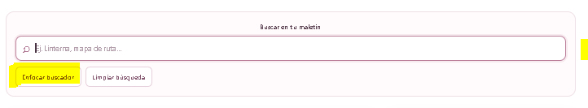
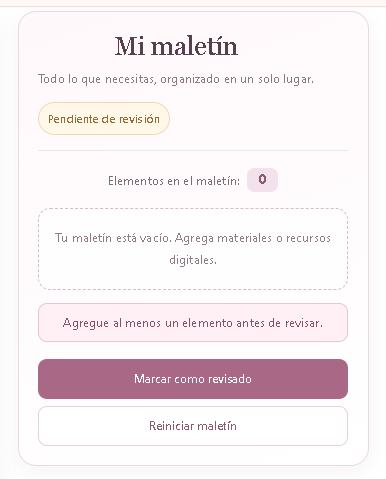

# Maletín de salida

Aplicación web desarrollada con React 19, TypeScript y Vite para organizar materiales físicos y recursos digitales necesarios antes de una salida. Permite consultar dos catálogos, buscar elementos y administrar una lista personal de artículos en un solo lugar.

El proyecto integra el uso de estado local, reducers, referencias tipadas, componentes genéricos y composición de componentes reutilizables.

## Tecnologías utilizadas

- **React 19:** construcción de la interfaz mediante componentes reutilizables.
- **React DOM:** representación de los componentes en el navegador.
- **TypeScript:** tipado estático para mejorar la seguridad y el mantenimiento del código.
- **Vite:** servidor de desarrollo y herramienta de compilación.
- **CSS3:** diseño adaptable con una identidad visual en tonos rosa empolvado y malva.
- **ESLint:** análisis estático del código.

## Requisitos previos

Para ejecutar el proyecto se necesita:

- Node.js compatible con la versión de Vite instalada.
- npm.
- Visual Studio Code u otro editor de código.

## Instalación y ejecución

1. Clonar o descargar el repositorio desde GitHub.
2. Abrir una terminal en la carpeta raíz del proyecto.
3. Instalar las dependencias:

   ```bash
   npm install
   ```

4. Iniciar el servidor de desarrollo:

   ```bash
   npm run dev
   ```

5. Abrir en el navegador la dirección local que muestre Vite en la terminal.

## Compilación de producción

Para comprobar el proyecto y generar los archivos de producción, ejecutar:

```bash
npm run build
```

La compilación se realizó correctamente durante la validación, sin errores de TypeScript ni de compilación. El comando genera la carpeta `dist/` con los archivos optimizados para producción.

## Funcionalidades

- Visualización de dos catálogos: materiales físicos y recursos digitales.
- Búsqueda de elementos por nombre o título.
- Filtrado de resultados según el texto ingresado.
- Limpieza del campo de búsqueda.
- Enfoque del buscador mediante una referencia tipada.
- Catálogos genéricos para presentar diferentes tipos de elementos.
- Incorporación de elementos al maletín.
- Prevención de elementos duplicados.
- Conservación del orden de incorporación.
- Eliminación individual de elementos.
- Revisión del maletín cuando contiene elementos.
- Validación que impide revisar un maletín vacío.
- Reinicio del maletín.
- Visualización del total de elementos y del estado de revisión.
- Diseño adaptable a diferentes tamaños de pantalla.

## Datos iniciales

La aplicación utiliza dos catálogos con cinco elementos iniciales:

| Catálogo | Elementos |
|---|---|
| Materiales físicos | Linterna, Cinta métrica y Botiquín |
| Recursos digitales | Guía de seguridad y Mapa de ruta |

Los materiales físicos contienen identificador, nombre y cantidad disponible. Los recursos digitales contienen código, título y formato.

Los datos iniciales se encuentran definidos en `src/data/initialData.ts`.

## Flujo principal de la aplicación

1. Al iniciar, se muestran los dos catálogos, el buscador y el maletín vacío.
2. El estado inicial del maletín es «Pendiente de revisión».
3. La persona usuaria puede escribir en el buscador para filtrar materiales y recursos digitales.
4. Puede seleccionar elementos de cualquiera de los dos catálogos para incorporarlos al maletín.
5. El resumen actualiza la cantidad de elementos y permite retirarlos individualmente.
6. El maletín puede marcarse como «Revisado» cuando contiene al menos un elemento.
7. Si se intenta revisar un maletín vacío, se conserva el estado pendiente y se muestra el mensaje: «Agregue al menos un elemento antes de revisar.»
8. La opción «Reiniciar maletín» elimina los elementos y devuelve el estado a «Pendiente de revisión».

## Estructura principal del proyecto

```text
maletin-salida/
├── screenshots/
│   ├── 01-vista-inicial.png
│   ├── 02-busqueda-enfoque.png
│   └── 03-maletin-revisado.png
├── src/
│   ├── components/
│   │   ├── CompositionPanel.tsx
│   │   ├── GenericCatalog.tsx
│   │   ├── KitSummary.tsx
│   │   └── SearchBox.tsx
│   ├── data/
│   │   └── initialData.ts
│   ├── reducers/
│   │   └── kitReducer.ts
│   ├── App.tsx
│   ├── App.css
│   ├── index.css
│   ├── main.tsx
│   └── types.ts
├── index.html
├── package.json
├── package-lock.json
├── tsconfig.json
├── tsconfig.app.json
├── tsconfig.node.json
├── vite.config.ts
└── README.md
```

## Componentes principales

| Componente | Responsabilidad |
|---|---|
| `App.tsx` | Integra los componentes, administra la búsqueda y conecta los catálogos con el estado del maletín. |
| `SearchBox.tsx` | Presenta el campo de búsqueda y expone una referencia tipada para enfocarlo. |
| `GenericCatalog.tsx` | Renderiza catálogos de diferentes tipos de datos mediante un componente genérico. |
| `CompositionPanel.tsx` | Proporciona una estructura reutilizable con encabezado, contenido y pie opcional. |
| `KitSummary.tsx` | Muestra los elementos incorporados, el total y el estado del maletín; permite retirar, revisar y reiniciar. |

## Conceptos de React y TypeScript aplicados

### 1. Estado local con useState

Se utiliza `useState` para controlar el texto del buscador. Su valor inicial es una cadena vacía. Cada cambio actualiza el estado y permite filtrar los materiales y recursos digitales mostrados. También permite limpiar la búsqueda y recuperar todos los elementos de los catálogos.

### 2. Estado complejo con useReducer

`useReducer` centraliza las operaciones del maletín mediante un reducer. Este procesa cuatro acciones:

- `add`: agrega un elemento si todavía no existe y conserva el orden de incorporación.
- `remove`: elimina un elemento mediante su clave.
- `markReviewed`: cambia el estado a revisado únicamente cuando el maletín contiene elementos.
- `reset`: vacía la lista y devuelve el estado a pendiente de revisión.

Las acciones utilizan discriminantes y datos específicos para cada transición, manteniendo organizada la lógica del estado.

### 3. Referencias tipadas

`SearchBox` utiliza `forwardRef`, `useRef` y `useImperativeHandle` para exponer el método `focus()`. De esta manera, el componente padre puede enfocar el campo de búsqueda desde un control externo sin acceder directamente a su implementación interna ni exponer el elemento DOM.

### 4. Componentes genéricos

`GenericCatalog<T>` permite presentar distintos tipos de datos utilizando una misma estructura reutilizable.

Se utiliza en dos instancias:

- Materiales físicos: conserva el tipo correspondiente a los objetos que contienen `id`, `name` y `quantity`.
- Recursos digitales: conserva el tipo correspondiente a los objetos que contienen `code`, `title` y `format`.

Sus propiedades tipadas reciben los elementos, una función para obtener su clave, una función para representarlos y una función para seleccionarlos. El parámetro genérico `T` permite que cada callback conserve el tipo específico de su catálogo sin utilizar `any`.

### 5. Composición de componentes

`CompositionPanel` utiliza `ReactNode` para recibir contenido variable mediante `header`, `children` y `footer`.

Se implementa en dos paneles:

- El primer panel contiene el catálogo de materiales físicos y su descripción.
- El segundo panel contiene el catálogo de recursos digitales y la acción para limpiar la búsqueda.

De esta manera, ambos paneles comparten una estructura visual, pero muestran contenido y acciones diferentes sin duplicar su implementación.

## Respuestas a las preguntas técnicas

**1. ¿Qué responsabilidad tiene `useState`?**

Administra el estado local del buscador, específicamente el texto ingresado por la persona usuaria. Permite actualizarlo, limpiar el campo y filtrar los elementos de ambos catálogos.

**2. ¿Qué transiciones concentra `useReducer`?**

Concentra las cuatro transiciones principales del maletín: agregar elementos sin duplicarlos (`add`), retirar elementos (`remove`), marcar como revisado cuando existe contenido (`markReviewed`) y reiniciar la lista junto con su estado (`reset`).

**3. ¿Qué operación expone la referencia?**

Expone la operación `focus()`, que permite enfocar el campo de búsqueda desde un control externo sin que el componente padre necesite conocer directamente el elemento DOM interno.

**4. ¿Cómo se conserva `T` en las dos instancias genéricas?**

El componente `GenericCatalog<T>` utiliza el parámetro genérico `T` para conservar el tipo de los elementos en sus propiedades y callbacks. La primera instancia recibe materiales físicos y la segunda recursos digitales. Así, cada catálogo mantiene sus propias propiedades y tipos sin recurrir a `any`.

**5. ¿Qué contenido cambia mediante composición?**

Cambia el contenido del encabezado, el cuerpo (`children`) y el pie de panel (`footer`). La estructura de `CompositionPanel` se mantiene, mientras que sus dos instancias presentan catálogos y acciones diferentes.

## Validación funcional

Se ejecutaron manualmente los ocho casos de prueba P1–P8. Todos funcionaron según lo esperado.

| Caso | Prueba | Resultado |
|---|---|---|
| P1 | Buscar «linterna» | Aprobado |
| P2 | Limpiar la búsqueda | Aprobado |
| P3 | Enfocar el buscador mediante el control externo | Aprobado |
| P4 | Intentar revisar el maletín vacío | Aprobado |
| P5 | Evitar agregar elementos duplicados | Aprobado |
| P6 | Retirar un elemento del maletín | Aprobado |
| P7 | Reiniciar el maletín | Aprobado |
| P8 | Agregar elementos de ambos catálogos | Aprobado |

**Resultado: 8 de 8 casos funcionales aprobados.**

También se comprobó la compilación de producción mediante `npm run build`, que finalizó correctamente.

## Evidencias de ejecución

Las siguientes capturas documentan los principales estados de la aplicación:

### 1. Vista inicial


### 2. Búsqueda y enfoque del buscador



### 3. Maletín revisado



Las capturas complementan la tabla de validación funcional P1–P8. Los casos de duplicados, maletín vacío, eliminación y reinicio también fueron comprobados manualmente.

## Diseño adaptable

La interfaz utiliza CSS para adaptar la distribución de los catálogos, el resumen del maletín, los botones y el buscador a diferentes tamaños de pantalla. Se mantiene una identidad visual en tonos rosa empolvado y malva, con una presentación clara y organizada.

